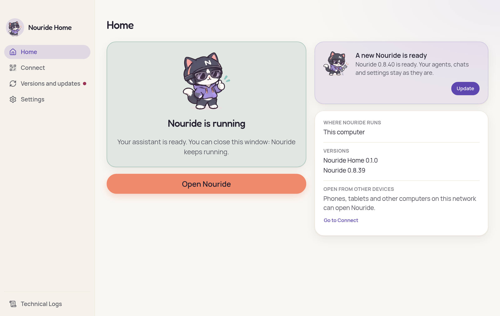

<div align="center">


# Nouride Home

### Nouride on your phone or your computer, no terminal needed

Nouride Home runs [Nouride](https://github.com/nouverse/nouride) on an Android phone or a Mac and keeps it running,<br>
or opens a Nouride that already runs on another computer.

[**Nouride**](https://nouride.com) · [**Guide**](https://nouride.com/en/docs/deployment/nouride-home/) · [**Releases**](https://github.com/nouverse/nouride-home/releases) · [**Nouride's source**](https://github.com/nouverse/nouride)

[](#licence)
[](https://github.com/nouverse/nouride-home/releases)
[](https://github.com/sponsors/gadingnst)
[](https://ko-fi.com/gadingnst)
[](https://trakteer.id/gadingnst)
[](https://karyakarsa.com/gadingnst)

<br>



</div>

<br>

## What it does

<table>
<tr>
<td width="110" align="center"></td>
<td><b>Your phone or your computer becomes Nouride's home.</b> The app installs Nouride with its official installer and
keeps it running, with the screen off on a phone and with the window closed on a Mac. An old phone in a drawer is
enough.</td>
</tr>
<tr>
<td align="center"></td>
<td><b>Or open the Nouride you already have.</b> Give the HTTPS address of a Nouride on another computer once, and the
app opens its dashboard. Nothing runs on the device itself.</td>
</tr>
<tr>
<td align="center"></td>
<td><b>Updates without a terminal.</b> The app says when a new Nouride is ready and puts it in, and the Android app
updates itself from this repository's releases. Your agents, chats and settings stay as they are.</td>
</tr>
<tr>
<td align="center"></td>
<td><b>Made for people who are not technical.</b> Every screen is written for the person holding the phone or sitting
at the computer. Logs and the rest live on one screen of their own, Technical Logs, for whoever helps them.</td>
</tr>
</table>

## Two apps, one release

Android and desktop live in this repository with one version (`VERSION`): a release `vX.Y.Z` is both.

| | Android | Desktop |
| --- | --- | --- |
| Code | `apps/android` (Kotlin) | `apps/desktop` (Tauri v2, React), `crates/` (Rust), `packages/ui-kit` |
| Status | Released (0.2.0), arm64 phones | v0.1, macOS on Apple Silicon; not part of a release yet |
| Download | [Releases](https://github.com/nouverse/nouride-home/releases): `nouride-home-X.Y.Z.apk` | Build it (below) |

What both do the same way (the address of another computer, which links stay in the dashboard's window, release
versions) is written once in `spec/`, with cases both apps' tests read.

## Android

An Android app for Nouride, two ways. The phone runs Nouride itself: choose **Run it on this phone** and Nouride runs
on the phone, reachable from the phone itself and from other devices on the same Wi-Fi. No Termux, no terminal. Or the
phone opens a Nouride that already runs on another computer: choose **Use Nouride on another computer** and give its
HTTPS address once, a computer at home behind a Cloudflare tunnel being the usual one.

The question is asked once, on the first screen of a phone without Nouride, and changed on More at any time. On another
computer the app runs nothing of its own; the Debian and Nouride this phone may already hold stay where they are, so
choosing this phone again picks the install up as it was.


### What it does

- Carries proot and a Debian arm64 system inside the APK. On the first start it unpacks Debian, then runs the official
  Nouride installer inside it (`https://get.nouride.com/install.sh`), so the phone gets the same Nouride as any Linux
  install, at the latest release.
- Keeps Nouride running from a foreground service, with the screen off, and starts it again if it stops on its own.
- Shows whether Nouride is running and opens the dashboard inside the app; its Connect tab has a QR code and the
  address for opening Nouride on a tablet, a computer or another phone on the same Wi-Fi.
- Opens a Nouride that runs on another computer instead, if that is what the person chooses: its dashboard, over the
  HTTPS address that computer is reached at, with its own login page as the way in. Home says whether it answers. The
  choice and the address are changed on More, either way.
- Starts Nouride again after the phone restarts, once the phone has been unlocked (on some Xiaomi phones, once
  Autostart allows it).
- Updates itself: when a newer release is on this repository's Releases page, the app says so (a card on its screen
  and in its notification), downloads it, checks its sha256 and hands it to Android's installer. Nouride, Debian and
  the agents stay as they are, and Nouride starts again by itself once the new version is in.

Nouride listens on its default port, `18254`. The dashboard is `http://<the phone's address>:18254/dashboard/`.

Limits: arm64 phones only (Nouride has no 32-bit ARM build), sideloaded (not on Google Play: `targetSdk` is 28 on
purpose, see `AGENTS.md`). Another computer is reached over HTTPS only: the app speaks plain HTTP to its own daemon on
the loopback and to nothing else (`res/xml/network_security_config.xml`), and a dashboard on the open internet is a
login, so a password on the wire is not offered.

### Download

The APK of each release is on the [Releases](https://github.com/nouverse/nouride-home/releases) page,
`nouride-home-X.Y.Z.apk`, with its sha256. Open it on the phone and allow installing from that app when Android asks.
Every release is signed with the same key, so a new one installs over the old one and keeps Nouride's data. After
the first install the app finds its own updates; the first one asks once to allow installing from Nouride Home.
More, then Versions and updates, shows the app's version and Nouride's, and updates either from there.

### Releasing

First make VERSION say X.Y.Z on `main` (`scripts/bump-version X.Y.Z`, in a pull request). Then publish a release
`vX.Y.Z` on GitHub (Releases → Draft a new release, a new tag on `main`). The `Release` workflow runs on that, never
on a push, and refuses a tag that is not VERSION: it builds the APK from the pinned inputs, runs the unit tests, signs it with the
release key (the repository's `NOURIDE_HOME_*` secrets), checks the signature against `scripts/release-cert.sha256`,
and attaches it to the release. Run the workflow by hand for a dry run of VERSION: the APK is kept as the run's artifact and nothing is published. The release key is the owner's; losing it means no phone
can update to a later release without uninstalling, so it is kept outside the repository and backed up.

### Building

Everything installs without root, into one directory:

```sh
scripts/setup-toolchain.sh ~/android-toolchain   # JDK 17, Android SDK, build tools, NDK
. ~/android-toolchain/env.sh
scripts/build-proot.sh                           # proot for arm64 Android, into apps/android/app/src/main/jniLibs/
scripts/build-rootfs.sh                          # the Debian arm64 layer, into apps/android/app/src/main/assets/rootfs.tgz
cd apps/android && ./gradlew assembleDebug testDebugUnitTest
```

The APK is `apps/android/app/build/outputs/apk/debug/app-debug.apk`. Every downloaded input is pinned by sha256 in
`scripts/assets.lock`; the built proot and rootfs are not committed.

### Installing on a phone

```sh
adb install -r apps/android/app/build/outputs/apk/debug/app-debug.apk
```

The debug build is another app beside the release, so a developer's phone can keep both: **Nouride Home Dev**
(`tech.nouverse.nouride.home.dev`), with a yellow icon, its own Debian and Nouride, Nouride on `18264` and its LLM
gateway on `18266` (the release: `18254` and `18256`), and its own way back from a sign-in (`nouridehome-dev://`).
Testing it never stops or replaces the Nouride the release runs. It is never offered an update.

Over wireless ADB, Google Play Protect asks for a confirmation on the phone's screen: someone has to be at the phone
to tap it, or the install is refused.

## Desktop

A desktop app for Nouride, two ways, as the Android app is. The computer runs Nouride itself: choose **Run it on this
computer** and the app installs Nouride with the official installer and keeps it running, reachable from this
computer and, when allowed, from other devices on the same network. Or the computer opens a Nouride that already runs
somewhere else: choose **Use Nouride on another computer** and give its HTTPS address once.

Its icon sits in the menu bar: the state in one line, opening the app or the dashboard, starting or turning off
Nouride, and a new version when one is ready. Closing the window keeps it there.

Status: v0.1, macOS on Apple Silicon. Linux is planned and the code is kept ready for it. Builds are not signed with a
Developer ID yet; see `docs/rfc/0001-desktop-v0.1.md`.

### What it does

- Asks once where Nouride should run, and changes it in Settings at any time.
- On this computer: uses a Nouride that already answers on this computer's default port, or installs one with
  `https://get.nouride.com/install.sh` into the app's own folder (`~/Library/Application Support/<bundle id>/nouride`)
  and keeps it running as the app's own LaunchAgent, so Nouride runs whether or not the app is open, and starts again
  at login.
- Opens the dashboard in a window of the app, signed in with the account the app made on the first setup. Links to
  anything but Nouride open in the browser.
- Says when a new Nouride is ready (on Home, in the menu bar and with a dot on Versions and updates) and puts it in through Nouride's own update.
  The app's own updates come from this repository's Releases through Tauri's updater; none is published yet.
- Connect: lets other devices on the same network open Nouride (off as installed), with a QR code.
- Technical Logs, at the bottom of the sidebar, holds what a helper needs: the state, the app's events and Nouride's log.

What it is built on: [Tauri](https://tauri.app) 2 (the window, the WebView, the tray and the updater are Tauri's and
the system's WebKit), React and Tailwind for the screens, and launchd for keeping Nouride running. Nouride itself is
downloaded and checked by its own installer.

### Building

Needs Rust (through rustup, `rust-toolchain.toml` pins it), Bun 1.4, and on macOS the Xcode Command Line Tools.

```sh
bun install --frozen-lockfile
for d in crates/*/; do (cd "$d" && cargo test -q); done     # the logic, on any OS
(cd apps/desktop && bun test && bun run build)               # the screens
cd apps/desktop
bun run build:dev        # Nouride Home Dev: tauri build --debug --features dev --config src-tauri/tauri.dev.conf.json
bun run build:release    # Nouride Home (both build the screens first)
```

The Tauri CLI runs under Bun (`bun --bun`), so Node is not needed.

The app is `target/<debug|release>/bundle/macos/Nouride Home[ Dev].app`, under the repository's root.

### The Dev build

**Nouride Home Dev** (`tech.nouverse.nouride.home.dev`) is another app beside the release, so a developer's Mac can
keep both: the cat on yellow, its own folder, Nouride on `18264` and its LLM gateway on `18266` (the release: `18254`
and `18256`), its own LaunchAgent and link scheme. Testing it never stops or replaces the Nouride the release runs, or
one installed by hand. It is never offered an update, and it alone answers the e2e hooks (`--e2e <action>`, see the
contributing skill).

## Layout

| Path | What it is |
| --- | --- |
| `apps/android/app/src/main/kotlin/.../server/` | The foreground service, the supervisor that restarts Nouride, the health check, proot's command line, where Nouride runs (`Place`, `RemoteHost`, `RemoteReply`) |
| `apps/android/app/src/main/kotlin/.../install/` | Unpacking the Debian rootfs and running the installer on the first start |
| `apps/android/app/src/main/kotlin/.../ui/` | The tabs (Home, Connect, More), the address card, the dashboard in a WebView, Technical Logs |
| `apps/android/app/src/main/kotlin/.../power/` | The battery exemption and the phone's own battery settings |
| `apps/android/app/src/main/kotlin/.../boot/` | Starting on boot |
| `apps/android/app/src/test/` | Unit tests, on the JVM |
| `apps/desktop/src-tauri/` | The Tauri binary: windows, the tray, commands. Wiring only |
| `apps/desktop/src/` | The desktop's screens (React, Tailwind), by module: first-run, home, connect, versions, settings, logs |
| `crates/shared/` | The build's names and ports, and the types the other crates share |
| `crates/place/` | Where Nouride runs, and the other computer's address (`RemoteHost`, `RemoteReply`) |
| `crates/daemon/` | Nouride on this computer: health, the installer's run and progress, `.env` and `config.toml`, the first account, the state |
| `crates/service/` | The LaunchAgent and `launchctl` |
| `crates/updates/` | Nouride's update routes, its notice, the stall watch, versions |
| `crates/link-policy/` | What stays in the dashboard's window, and Back |
| `crates/looks/` | Each state's sentence, cat and button, as keys into the words |
| `packages/ui-kit/` | Colours, fonts, the cat's poses, shared React pieces, the words |
| `spec/` | The behaviour both apps share, and the fixtures both test suites read |
| `assets/` | Icons and brand, the source for both apps |
| `scripts/` | The Android toolchain, proot and rootfs builds, `assets.lock`, the release certificate; the desktop's Mac scripts and icons; `bump-version` |
| `experiments/` | What was tried and measured on real phones and computers, a folder per run |

## Working on it

Read `AGENTS.md` first. The skills in `.agents/skills/` hold the detail: `home-ui` for anything a person sees,
`home-contributing` for building, testing and the rules of the code, each with a page per app in `references/`.

## Licence

Nouride Home is licensed under the [GNU Affero General Public License v3.0 only](./LICENSE) (`AGPL-3.0-only`). You may
use, change and share it; a changed version you give to others, or let others use over a network, comes with its
source under the same licence.

Nouride itself, which the apps install and run, is a separate program with its own licence (`FSL-1.1-ALv2`, see
[its repository](https://github.com/nouverse/nouride)). The Nouride name, the Nouride Home name, the cat and the logo
are trademarks of Nouverse and are not licensed: a changed copy is not called Nouride or Nouride Home. The licence text
governs; this summary does not replace it.

<br>

<div align="center">

<br>
<sub>Made by <a href="https://nouverse.com">Nouverse</a>.</sub>
</div>
